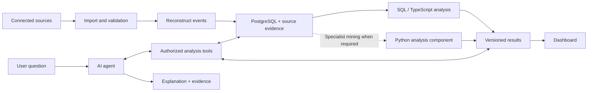

# AI Process Mining Agent — Product Delivery Plan

Updated: 2026-10-17

Status: agreed direction, ready to guide implementation. Timelines are estimates.

This plan supersedes the implementation assumptions in the earlier [project brief](ai-process-mining-agent-project-brief.md). The brief remains useful as background.

## 1. Product direction

Build a general service that helps companies understand how work happens, identify problems, and evaluate improvements. Users describe a question, connect relevant sources, review a reconstructed process, and investigate evidence through a dashboard and conversation.

The product is not limited to one business process or to CSV/Excel. Its analysis model is reusable, while integrations and supported evidence formats expand incrementally.

### Confirmed decisions

| Area | Decision |
|---|---|
| Team | Two full-time engineers |
| First release | Fully synthetic, prepared, guided public demo |
| Language | French interface, explanations, and marketing walkthrough |
| Demo workflows | Customer support, purchasing approvals, employee onboarding |
| Interaction | Highlighted controls and supported typed questions |
| Product application | Primarily TypeScript, Next.js, and React |
| Hosting | Cloudflare for the landing page, demo, live frontend/backend, and supported background processing |
| Public addresses | avatar-ai.xyz (landing), demo.avatar-ai.xyz (demo), app.avatar-ai.xyz (live product) |
| Live identity and database | Supabase Auth and Supabase PostgreSQL |
| Live document storage | Private Supabase Storage |
| Hosted AI | Claude API as a replaceable initial planning default; OpenAI API remains an option |
| Analysis | SQL for standard metrics; TypeScript for initial processing; a separate Python component when specialist mining algorithms are required |
| Improvements | Propose fixes first; introduce approved write actions in a later release |

A mostly TypeScript application does not imply that all process mining must be implemented in TypeScript.

### Release sequence

1. Publish a credible synthetic demo that explains the product and supports marketing.
2. Recruit customers and validate real data through a bounded private pilot.
3. Turn recurring customer problems into tested, reusable improvement proposals.
4. Add controlled execution only after proposing, reviewing, testing, and measuring fixes works reliably.

## 2. First release: a prepared synthetic demonstration

### Purpose

The demo is a lasting product asset for customer interviews, self-guided exploration, team presentations, and an announcement video.

Everything is generated beforehand: source records, event histories, metrics, findings, conversation answers, evidence, and proposed improvements. Visitors experience realistic interactions without customer data, live integrations, or runtime model calls.

### Visitor journey

1. Choose a sample workflow.
2. Select a prepared starting question.
3. Simulate connecting the scenario's tools.
4. Confirm the proposed process boundary and period.
5. Resolve one ambiguous relationship between records.
6. Start analysis and see short, skippable progress.
7. Explore the process map, metrics, comparisons, findings, and cases.
8. Open the evidence supporting a finding.
9. Type supported follow-up questions and see the corresponding dashboard view.
10. Inspect a proposed improvement, including assumptions, exceptions, and how success would be measured.

Use highlighted controls and French instructions to guide each step. Advance on the required action rather than on a fixed timer.

Include back, restart, scenario switching, and local progress persistence. Reset and scenario switching must clear incompatible state.

Display a persistent disclosure: **“Démonstration guidée · Données fictives.”** Explain that connections, processing progress, and agent responses are prepared. Do not imply live integrations or autonomous investigation.

### Three scenarios

| Workflow | Synthetic sources | Main pattern | Proposed improvement |
|---|---|---|---|
| Customer support | Emails, tickets, escalation messages | Repeated transfers between teams | Improve initial routing |
| Purchasing approvals | Requests, approval messages, invoice records | Approved requests lack a reliable finance handoff | Create a finance task after approval |
| Employee onboarding | HR records, IT requests, checklists | Access preparation starts late | Trigger preparation when a start date is confirmed |

Each scenario contains approximately 200 cases over a fixed 90-day period, including open cases, alternative paths, repeated steps, and incomplete evidence.

Prepare three principal findings, six follow-up questions, source-linked examples, and one improvement proposal per scenario. Reuse the same interface and analysis definitions across all three.

Use fictional organizations, stable dates, deterministic identifiers, and a fixed generation seed. Any synthetic before/after example is explicitly labeled. Expected improvements remain hypotheses rather than promised savings.

### Conversation and dashboard

The chat accepts scripted text input. Normalize French accents, case, and punctuation, then match an explicit set of questions and aliases.

For unsupported questions, explain the demo's limits and offer three relevant supported questions. Preserve the visitor's current position. Never fabricate an answer or imply a live model handled it.

Dashboard filters select prepared views. Support full-period versus recent-period comparisons and all-team versus relevant-group views. Every visible control must resolve to consistent content.

The final action is **“Voir la proposition”**, followed by **“Préparer un pilote”** leading to a participation page and a configurable contact address. No automation is activated.

### Demo implementation

- Next.js, React, TypeScript, Tailwind CSS.
- Recharts for charts and SVG for the process map.
- Zod for validating scenario bundles.
- Node.js/TypeScript scripts for generation and offline metrics.
- Vitest for analysis and fixture checks; Playwright for user journeys.
- Static export served through Cloudflare Workers Static Assets, with a local command to serve the same production build.
- Neutral working title: **“Agent Process”** until branding is chosen.

The demo does not require PostgreSQL, Supabase Auth, workers, or a hosted AI API at runtime. Its offline calculations run in TypeScript; later SQL implementations must use the same metric definitions and regression examples.

Separate the application, shared domain types, scenario content, generation scripts, and analysis functions. Bundle required assets locally so the journey can continue without external requests after loading.

Store only tour and scenario progress locally. Keep typed questions in memory and clear them on reset. Include keyboard access, visible focus, responsive layouts, and reduced motion.

## 3. Analysis architecture: SQL, TypeScript, and Python

### Why the responsibilities are split

Language choice is not a blanket performance decision. SQL executes inside PostgreSQL regardless of the caller. Algorithm choice, data volume, native libraries, and data movement determine execution performance.

TypeScript keeps the initial application and demo straightforward. SQL handles standard aggregations close to stored data. Python becomes valuable where established mining libraries save implementing complex algorithms from scratch.

### Responsibilities

| Work | Initial implementation | Reason |
|---|---|---|
| Synthetic generation and demo metrics | TypeScript scripts | Repeatable build-time preparation with shared tooling |
| Counts, durations, group comparisons, elapsed intervals | PostgreSQL SQL in the live product | Query and aggregate near the data |
| Validation, orchestration, initial event processing | TypeScript | Shared application contracts |
| Basic path frequencies and directly-follows maps | SQL plus TypeScript | Sufficient for the first bounded feature set |
| Structured process discovery and conformance checking | Python when required | Reuse specialist algorithms |
| Object-centric mining and advanced statistical analysis | Python when required | Richer mining/data-analysis ecosystem |

For initial metrics, calculate completed/open counts, median and 90th-percentile duration, common paths, repetitions, handoffs, elapsed intervals, comparisons, and coverage.

Open cases remain visible but are excluded from completed-case duration metrics. Describe elapsed time as waiting time only when evidence supports it. Do not imply that a directly-follows map captures all concurrency or proves causation.

### Python integration boundary

Define a versioned analysis interface from the start:

- Input: authorized event dataset or dataset reference, process definition, metric/algorithm selection, filters, and data/mapping version.
- Output: structured metrics, model/map data, findings inputs, evidence references, warnings, and analysis version.
- Execution: synchronous for bounded calculations; durable jobs for heavier work.
- Persistence: save completed results for dashboard queries; do not recompute deep mining on every chat question.

Introduce Python behind that interface once a required algorithm or benchmark justifies it. Keep the user-facing application, authentication, and orchestration in TypeScript.

Evaluate PM4Py for specialist mining, subject to its AGPL/commercial licensing terms before adoption. Maintain common reference datasets so SQL, TypeScript, and Python results agree on shared metrics.

Keep bulk calculations in PostgreSQL where appropriate and orchestration in Cloudflare Workers. Standard Workers currently have a 128 MB memory limit per isolate and CPU limits that vary by invocation type. A long-lived Workflow does not provide unlimited CPU or memory. Do not assume native Python mining packages run unchanged in the Workers runtime. Benchmark specialist workloads; if one cannot fit the supported environment, execute it through a separately managed compute service behind the versioned analysis interface. That service introduces its own cost. No Python service is needed for the synthetic demo.

## 4. Live product architecture

### Services

| Layer | Selected direction |
|---|---|
| Landing page | Existing static site migrated to Cloudflare Workers Static Assets |
| Public demo | Next.js static export on Cloudflare Workers Static Assets |
| Live frontend and backend | TypeScript/React application hosted on Cloudflare Workers |
| Background orchestration | Cloudflare Workflows and Queues |
| Authentication | Supabase Auth |
| Relational data | Supabase PostgreSQL |
| Original files | Private Supabase Storage |
| Interpretation and explanation | Hosted model through a provider adapter |
| Standard calculations | SQL and TypeScript |
| Specialist mining | Optional Python analysis component |

Workers execute application requests; Workflows coordinate durable steps; Queues buffer independently retryable work. Store job status in PostgreSQL and make consumers idempotent. Bound payloads, concurrency, retries, and step counts. Validate representative imports against current runtime limits.

Next.js remains the static demo framework. For the live application, validate its required server features using Cloudflare's current deployment guidance before committing to framework-specific backend features. Cloudflare currently recommends vinext for new Next.js-style applications and documents OpenNext for existing deployments. Full Node.js compatibility must not be assumed. Keep business services independent of the framework adapter.

Use separate Cloudflare deployments for the landing page, demo, and live app. Supabase and the hosted model remain external services. Cloudflare's website Free/Pro subscription and Workers Paid are different products; do not buy a website Pro upgrade merely to enable Workers Paid.

Claude API is the initial planning default, not a finalized model selection. Evaluate candidate models for French quality, tool-call correctness, latency, and cost before customer deployment. Keep provider-specific code behind an adapter; do not build two providers before needed.

### Data flow

Keep raw source evidence, normalized events, definitions, mapping corrections, jobs, results, and conversations distinct.

Events retain activity, event time, ingestion time, case/object relationships, source reference, and whether the interpretation is recorded or inferred. Uncertain links must remain reviewable. Preserve multi-object relationships instead of irreversibly flattening everything into one case.

### Shared types and application interfaces

Define ProcessDefinition, SourceRecord, Event, AnalysisSnapshot, Finding, EvidenceReference, FixProposal, and DashboardView. The demo adds ScenarioBundle, ScriptedAnswer, and TourStep.

The UI reads data through a repository/service interface. Static bundles implement it first; authenticated live services later return compatible view models.

Initial live capabilities:

- Create process workspaces and manage company membership.
- Register sources and start imports.
- Inspect coverage and proposed mappings.
- Confirm corrections.
- Run analyses and retrieve progress.
- Retrieve versioned dashboards, findings, and evidence.
- Ask questions and receive streamed explanations.

No public ingestion endpoint or live connector is needed for the synthetic release. Choose pilot connectors after inspecting authorized customer data.

### Agent responsibilities

Provide bounded tools for inspecting data, proposing mappings, requesting calculations, comparing groups, retrieving evidence, and selecting dashboard views.

The model clarifies ambiguity, chooses authorized tools, and explains structured results. Code supplies numerical facts and permissions. Do not give the agent unrestricted SQL execution.

Each finding includes the observation, calculation and scope, source evidence, data version, limitations, and suggested investigation. Keep associations distinct from proven causes.

## 5. Access, data governance, performance, and operations

### Identity and company isolation

Use Supabase Auth for identities and sessions. Link application profiles to Auth user IDs; keep organization memberships, roles, and process permissions in application tables.

Enforce backend authorization and PostgreSQL row-level security. Privileged service credentials may bypass policies and must not be treated as proof of user access. Carry company scope through jobs, caches, files, tool calls, and evidence retrieval.

Keep the public synthetic demo isolated from live customer environments. Choosing Clerk or another provider later requires an explicit migration; application-owned membership and permission models make that transition more manageable.

### Data handling

Use scoped read access to sources initially. Store connection secrets server-side. Login with Google/Microsoft does not itself grant access to customer emails or documents; source connections require their own authorization.

Treat imported content as untrusted data. Establish retention, deletion, backup restoration, and model-provider data handling before customer onboarding. Send only task-relevant authorized context to the hosted model.

### Reliability and faster results

- Make imports repeatable without duplicating records.
- Handle changed and out-of-order events.
- Recompute affected cases after updates or mapping corrections.
- Save metrics and analysis results rather than repeating the full pipeline for every question.
- Separate heavy imports from interactive work.
- Scope caches by company, permissions, filters, and data/mapping version.
- Show coverage and freshness alongside results.
- Track queue delay, retrieval, reconstruction, calculations, model latency, and cost separately.

Set customer-facing performance targets after representative benchmarks. Start with configured usage quotas, model-call budgets, monitoring, failed-job recovery, and tested backup restoration.

PostgreSQL is the initial live database. Consider ClickHouse, DuckDB, or distributed processing only for demonstrated workload needs; they do not replace evidence reconstruction or validation.

### Cost model and controls

Cloudflare is selected for its fit and lower entry cost for this design, not as a guarantee that it is always cheaper than Vercel. The Workers Paid subscription is a minimum charge with usage allowances, not a fixed all-inclusive bill.

Pricing reference checked on 2026-10-17; USD before applicable taxes:

| Resource | Included usage | Additional usage |
|---|---|---|
| Workers Paid subscription | $5/month minimum per account | Usage charges below and any other enabled products |
| Dynamic Worker requests | 10 million/month | $0.30 per additional million |
| Active CPU | 30 million milliseconds/month, about 8.3 hours | $0.02 per additional million milliseconds |
| Direct static asset requests | Free and unlimited | Invoking Worker code may incur request/CPU usage |
| Queues | 1 million operations/month | $0.40 per additional million operations |
| Workflow steps | 500,000/month | $0.80 per additional 100,000 |
| Workflow state storage | 1 GB-month | $0.20 per additional GB-month |

Workflows share Workers request and CPU allowances; they do not provide a second independent allotment. A queue message normally requires write, read, and delete operations; retries add operations. Workflow state retention also affects storage usage. Check current billing semantics before release.

Standard Workers do not add egress/bandwidth charges, but other products can have separate billing. R2, KV, Durable Objects, logs, builds, image processing, Containers, or other services must be budgeted if introduced. Do not enable optional products without identifying their meter and intended use.

The static landing page and prepared demo can fit the Free plan within published build, asset, and deployment limits. They do not need paid Workers or model calls simply because visitors explore them. Select Workers Paid when the live workload needs it; free dynamic execution limits are not suitable assumptions for heavy processing.

Supabase, the hosted AI API, domain renewal, any email delivery service, and any specialist compute service are separate cost lines. Moving hosting does not eliminate these costs.

Controls required before a real-data pilot:

- Engineer B maintains an inventory of enabled services, pricing, expected usage, and cost per customer.
- Record baseline, expected, and high-load estimates from representative imports and questions.
- Configure per-company import, file-size, concurrency, query, and model-token quotas; check them before accepting expensive work.
- Set Worker CPU limits and bounded retry/step limits. Keep heavy payloads in storage and pass references.
- Track usage across Workers, Workflows, Queues, Supabase, and model calls; configure budget alerts.
- Provide a server-enforced switch to pause new costly jobs and model calls while preserving access to existing results.
- Treat alerts and per-invocation CPU limits as controls, not an account-wide hard spending cap.
- Document whether each provider offers a hard cap; do not promise a universal cap without verifying enforcement.

Before enabling paid live services, record the chosen operating budget and quota configuration. No monthly cost estimate is a guarantee without workload assumptions.

### Domain migration and cutover

The domain remains avatar-ai.xyz. Host the existing landing page on avatar-ai.xyz, the prepared demo on demo.avatar-ai.xyz, and the live application later on app.avatar-ai.xyz. Subdomains require DNS configuration, not separate domain purchases.

1. Inventory current DNS, hosting, redirects, and any mail-related records. Confirm account and registrar access.
2. Deploy the existing landing page to a Cloudflare preview and verify pages, images, links, forms, and mobile behavior.
3. Deploy the demo separately and verify its full guided journeys.
4. Configure custom domains and TLS, then update only the required DNS records. Preserve email records and other unrelated services.
5. Verify HTTPS, apex/www redirects, deep links, assets, and landing-to-demo navigation on the actual domains.
6. Retain the Vercel deployment for rollback during the cutover; remove its domain association and paid subscription only after successful verification, if no other projects depend on them.
7. When the live app exists, configure its own authentication redirects, origin checks, and cookie scope; customer sessions must remain separate from the public demo.

This document records the migration plan. No hosting account, DNS record, deployment, or subscription is changed by updating it.

## 6. Delivery and ownership

### Demo: four-week planning estimate

| Week | Engineer A | Engineer B | Exit condition |
|---|---|---|---|
| 1 | Interface shell, design system, guided flow | Types, generator, metrics, first scenario | One complete journey |
| 2 | Dashboard, evidence viewer, conversation | Three datasets, comparisons, prepared answers | All scenarios use shared components |
| 3 | Responsive design, accessibility, recording mode | Validation, reset/recovery, regression checks | Every displayed result agrees with records |
| 4 | User walkthroughs, French marketing materials | Performance checks, Cloudflare deployment, verified landing-page cutover | Publishable release candidate |

Review progress weekly. The schedule is an estimate rather than a committed launch date.

Engineer A owns experience and marketing presentation. Engineer B owns data integrity, analysis, and infrastructure. Both review security, metric meaning, and releases.

### Required acceptance checks

- Fixed seeds produce reproducible datasets.
- Independently verified expected results agree with calculations.
- Every finding, answer, chart, and evidence reference resolves.
- Duplicate records, missing timestamps, open cases, and uncertain links receive documented handling.
- All three workflows complete end to end, including back, reset, refresh, and scenario switching.
- Supported typed questions and aliases work; unsupported questions receive the explicit fallback.
- Prepared dashboard changes target under 200 ms on the agreed test laptop.
- Keyboard access, mobile layouts, and reduced motion work.
- No customer records, credentials, live model calls, or live integrations are present in the public build.
- Any apparent automated action is clearly simulated.
- Cloudflare preview and production assets, redirects, deep links, and scenario routes work.
- The static demo does not accidentally invoke backend code or paid services.

For live analysis, additionally test cross-company access attempts, source permissions, retries, mapping corrections, model/tool failures, deletion, and result consistency across implementations. Validate memory/CPU bounds, duplicate queue delivery, exhausted quotas, and the costly-job pause switch. Test the application in the Cloudflare runtime, not only a local Node.js development server.

Conduct five moderated walkthroughs before publication. Target at least four users completing the main journey without developer intervention and accurately explaining the finding and proposal.

### Release and marketing deliverables

Deliver the public demo, local presentation build, generator, analysis scripts, tests, developer README, scenario documentation, screenshots, and a French 60–90-second announcement storyboard and narration.

Use one scenario in the video: question -> connected evidence -> finding -> investigation -> proposed improvement. Keep the synthetic disclosure visible.

Add a recording mode with stable dimensions, a known starting state, and repeatable actions. Publish a preview, verify hosted assets and journeys, then promote the tested build. Retain the previous build for rollback.

## 7. Private pilot and commercialization

Use the demo to recruit three prospective teams. Interview process owners about current investigation effort, available history, meaningful decisions, and willingness to pay.

Select one pilot with authorized data, a measurable problem, and a named process owner.

Before connector implementation:

1. Inspect a representative sample.
2. Verify historical coverage and record-linking feasibility.
3. Agree on process boundaries and supported sources.
4. Document success criteria, support ownership, retention, and pilot end date.
5. Review applicable customer, hosting, and model data requirements.

Choose integrations from this evidence. Keep the general engine while expanding source support incrementally.

Implement one live vertical slice: authenticate -> connect -> import -> reconstruct -> review mappings -> analyze -> explain -> investigate.

Review reconstructed histories with the process owner and independently verify important calculations. Benchmark representative data and adjust scope before making performance promises.

Estimate the live pilot separately after the data review. End the bounded pilot with a documented decision: improve, convert to paid use, or stop. Define pricing from observed value, operating costs, and willingness to pay rather than from synthetic demo results.

## 8. Reusable fixes and later evolution

Maintain an internal registry of recurring problems:

- Detection evidence and applicability conditions.
- Required integrations and permissions.
- Generalized fix logic and exceptions.
- Proposed success metric and observed outcomes.

Prioritize fixes by frequency, impact, detectability, and implementation risk. Match underlying conditions rather than applying one solution to every similar symptom.

Start with customer-facing proposals. Later, build reviewable drafts, test them, apply approved changes, and measure the effect. Autonomous execution requires a separate scoped design and authorization.

Keep customer records private when generalizing improvement templates. A template contains reusable logic; each customer receives its own configuration and permissions.

## 9. Supporting references

- [Next.js static exports](https://nextjs.org/docs/app/guides/static-exports)
- [Cloudflare Workers Static Assets](https://developers.cloudflare.com/workers/static-assets/)
- [Cloudflare Workers pricing](https://developers.cloudflare.com/workers/platform/pricing/)
- [Cloudflare Workers limits](https://developers.cloudflare.com/workers/platform/limits/)
- [Cloudflare Workflows pricing](https://developers.cloudflare.com/workflows/reference/pricing/)
- [Cloudflare Queues pricing](https://developers.cloudflare.com/queues/platform/pricing/)
- [Cloudflare framework deployment guidance](https://developers.cloudflare.com/workers/framework-guides/automatic-configuration/)
- [Supabase Auth architecture](https://supabase.com/docs/guides/auth/architecture)
- [Supabase connection management](https://supabase.com/docs/guides/database/connection-management)
- [Supabase Storage](https://supabase.com/storage)
- [PostgreSQL window functions](https://www.postgresql.org/docs/current/functions-window.html)
- [PM4Py features](https://processintelligence.solutions/pm4py/features)
- [PM4Py and licensing](https://processintelligence.solutions/pm4py/)
- [Claude API model documentation](https://platform.claude.com/docs/en/models/overview)

Provider limits, availability, licensing, and commercial terms must be checked again when adopting or provisioning a service.
