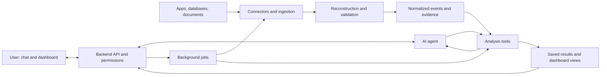

# AI Process Mining Agent: Product and Technical Brief

> Working concept consolidated from the project discussion on October 10–11, 2026.
> This document describes a proposed product and architecture. It is not an implemented system, a finalized specification, or a performance guarantee.

## 1. Product idea

Build an AI agent that connects to a company's business tools, reconstructs how work happens, analyzes the process, and delivers an interactive dashboard with clear explanations in everyday language.

Users should be able to ask:

- Why do our requests take so long?
- Where does work get stuck?
- Which steps are repeated unnecessarily?
- What changed between this month and last month?
- What should we investigate first?

Process mining uses recorded events to understand the paths work actually takes. The agent adds guided setup, interpretation of different sources, conversational investigation, and understandable explanations.

The product should support many kinds of processes and sources. CSV and Excel are useful import options, but they do not define the product's scope.

**French team pitch:** On connecte ses outils. L'agent IA relie les étapes, repère ce qui ralentit le travail, et présente un dashboard avec des explications simples. Pour aller plus loin, on discute avec lui.

## 2. General engine, focused first release

The architecture should support different workflows. The first release should demonstrate one real process across two connected systems and one useful document format.

A candidate is customer support across email and a ticketing system. Another is purchase approvals across messages, purchasing records, and invoice documents.

The first milestone is a trustworthy reconstruction of a real workflow, followed by a verified metric and an explanation linked to evidence. Initial support for every business app or document format is not required.

Before implementation, choose:

- The first user and business process.
- The decision that the analysis should help them make.
- The process start and end.
- The systems containing its history.
- A pilot customer or realistic dataset.
- A process owner who can validate the reconstruction.

## 3. Practical examples

The findings below are illustrative, not measured results or proven causes.

| Process | Sources | What the dashboard shows | Example finding and next investigation |
|---|---|---|---|
| Purchase approvals | Email, team chat, purchasing system, invoices | Approval durations, pending purchases, repeated approval loops | Requests above a threshold spend longer before finance approval; investigate reviewer availability |
| Customer support | Tickets, email, engineering issues, escalation channels | Resolution times, transfers, reopened tickets | Billing requests initially assigned to technical support take longer; investigate routing |
| Construction and maintenance | Inspection forms, contractor messages, work orders, completion reports | Open issues by room or site, materials delays, repairs awaiting inspection | Completed repairs remain open until inspection; investigate inspection scheduling |
| Employee onboarding | HR records, IT tickets, equipment orders, checklists | Readiness before the start date, missing access, equipment delays | Late access requests coincide with late account creation; investigate request timing |
| Sales to payment | CRM, proposals, contracts, delivery records, accounting | Stage durations, delivered work awaiting invoices, payment delays | There is a gap between delivery confirmation and invoicing; investigate the handoff to finance |

## 4. User experience

The interface is a web app with a chat alongside a persistent dashboard. Each process has its own workspace, sources, definition, conversation, and analysis history.

### First-time setup

1. The user selects "Analyze a process."
2. The agent asks what they want to understand.
3. The user describes the problem in ordinary language.
4. The agent asks where the work happens and offers relevant connections.
5. The user connects tools and selects projects, inboxes, teams, or other scopes.
6. The agent proposes a process definition and analysis period.
7. The user resolves material ambiguities.
8. The analysis runs and the dashboard opens.

Example: "Our requests arrive by email, we manage them in Jira, and sometimes discuss approvals in Teams."

The agent must establish what counts as one request, when it is finished, and how records across sources relate. Connecting an app alone does not answer these questions.

### Main workspace

| Area | User-facing behavior |
|---|---|
| Process overview | A map of steps, common paths, volumes, durations, and repeated steps |
| Findings | Plain-language observations, evidence, limitations, and suggested investigations |
| Chat | Follow-up questions that can run analyses and change dashboard views |
| Evidence | Source records supporting a selected result |
| Status | Data coverage, last refresh, missing sources, and job progress |

Chat and dashboard share the process, date range, filters, permissions, and analysis version.

For example, "Show requests that took more than three days" filters the dashboard and lets the user inspect those cases.

Use reusable, validated chart and table components. The agent configures these components with structured results.

## 5. Connections and supported evidence

| Connection route | Purpose |
|---|---|
| Business app APIs | Import records and activity histories from ticketing, CRM, ERP, HR, and other systems |
| Databases and warehouses | Read existing business events and operational records |
| Email and chat | Identify requests, decisions, follow-ups, and handoffs |
| Documents and files | Extract evidence from PDFs, forms, reports, logs, CSV, Excel, and other supported formats |
| Webhooks or ingestion API | Receive new events from custom applications |
| Interviews or manual forms | Describe offline steps or begin capturing events that software does not record |

Descriptions explain how a process is supposed to work. They cannot establish actual durations without historical evidence. A document's upload time is not necessarily the time its business event occurred.

### API and MCP roles

The product needs its own backend API for the web app, accounts, processes, analysis jobs, and results.

MCP can serve two different roles:

- **Inbound access:** The agent uses tools provided by source MCP servers to retrieve relevant data.
- **Outbound access:** A future MCP server exposes this product's analysis tools to external AI assistants.

MCP is optional. It does not replace source authentication, reliable ingestion, storage, or the analysis engine. Choose connection methods based on history coverage, permissions, pagination, filtering, and operational reliability.

### Connector requirements

Each connector needs scoped authentication, initial historical import, incremental updates, pagination, rate-limit handling, retries, duplicate prevention, and sync status.

It must handle changed records and disconnection, and support the product's retention and deletion policy.

Historical access is essential: a current status of "closed" does not reveal the transitions that preceded it.

## 6. Technical architecture

Start with a backend application and separate background worker processes. Split into more services only when workload or operational needs justify it.



| Component | Responsibility |
|---|---|
| Frontend | Guided setup, connections, chat, dashboard, evidence, progress |
| Backend | Accounts, company isolation, permissions, process configuration, APIs |
| Connectors | Source-specific retrieval and synchronization |
| Reconstruction | Extract events, link records, preserve uncertainty and provenance |
| Analysis engine | Reproducible calculations and process discovery |
| AI agent | Clarify goals, choose tools, investigate, explain, configure views |
| Workers | Run imports, extraction, analysis, and scheduled refreshes |
| Storage | Preserve source evidence, normalized events, definitions, and results |

## 7. Reconstructing processes from scattered records

A purchase may begin in email, be approved in chat, become an ERP order, and finish with an invoice. The system must connect these records without inventing missing events.

Use explicit identifiers and rules when available. AI can interpret free text and propose candidate matches. Uncertain matches should remain visible and correctable.

For each event, preserve:

- Activity and event time, if known.
- Case or related business object identifiers.
- Source system and source record.
- Supporting evidence or a reference to it.
- Whether the event was recorded directly or inferred.
- Uncertainty, mapping version, and relevant user corrections.
- Ingestion time separately from event time.

Example normalized event:

```json
{
  "case_id": "refund_482",
  "activity": "refund_approved",
  "occurred_at": "2026-10-09T14:30:00Z",
  "source_record_id": "ticket_event_921",
  "evidence_type": "recorded"
}
```

This is a minimal example. A production schema also needs company scope, event identifiers, provenance, and versioning.

Keep original evidence so analyses can be explained and rebuilt after corrections. Save mappings and corrections as structured application data rather than relying only on chat history.

Detect missing timestamps, duplicate events, conflicting records, uncertain relationships, and incomplete cases. Normalize time zones. Where one event relates to several objects, preserve those relationships; decide whether the first release analyzes one case perspective or needs richer object-based analysis.

## 8. Process analysis engine

Use deterministic code for metrics and process maps. The engine should support:

- End-to-end case duration.
- Elapsed time between recorded steps.
- Common paths and their frequency.
- Repeated activities and team transfers.
- Comparisons across periods or groups.
- Deviations from user-defined expectations.
- Incomplete cases and data coverage.

Metric definitions must be explicit. Decide how to treat open cases, business hours, outliers, overlapping work, and small samples.

**Elapsed time between events is not automatically waiting time.** Distinguishing active work from waiting requires additional evidence.

Store the metric definition, filters, sample size, exclusions, and data version with each result.

Example result:

> Median elapsed time from approval to payment: 2.8 days, across 420 completed refunds during September.

A suspected cause must be distinguished from an observed association. The agent should not promise that a suggested change will produce an unmeasured saving.

## 9. AI agent behavior

The agent is an LLM with a bounded set of tools and structured state.

| Example tool | Purpose |
|---|---|
| inspect_data | Inspect available fields, coverage, and quality |
| propose_process_mapping | Suggest cases, activities, relationships, and timestamps |
| analyze_process | Request defined calculations |
| compare_groups | Compare periods, teams, categories, or paths |
| get_evidence | Retrieve authorized supporting records |
| update_dashboard | Configure validated views from analysis results |

For "Why are refunds slow?", the agent checks the process definition, measures stages, compares relevant groups, retrieves evidence, and explains the observed patterns.

Each finding should include:

1. Observation.
2. Supporting metric and scope.
3. Evidence references.
4. Limitations or uncertainty.
5. Suggested next investigation.

The agent needs execution limits, tool parameter validation, failure recovery, and limits on time, cost, and tool calls. Independent evidence should support conclusions; model confidence alone is insufficient.

## 10. Proposed starting stack

These are candidate choices, not finalized dependencies.

| Layer | Proposed choice |
|---|---|
| Web interface | React / Next.js |
| Backend and analysis services | Python / FastAPI |
| Application data and normalized events | PostgreSQL |
| Original files and larger payloads | Object storage |
| Background work | Job queue and Python workers |
| Interpretation and investigation | LLM with tool calling |
| Efficient data operations | SQL and optionally Polars |
| Process mining algorithms | Evaluate a library such as PM4Py |

A semantic search index can help retrieve relevant document passages. A vector database is not required for process metric calculations.

Review dependency licensing before committing to a proprietary implementation. PM4Py provides AGPL and commercial licensing options.

## 11. Getting results to users faster

The performance priority is faster user results, rather than simply faster development.

A queue schedules work; a worker executes it. Replacing the queue or Python does not by itself resolve slow data imports, excessive model calls, or repeated computation.

### Two execution paths

**Background path:** Historical imports, OCR, extraction, record linking, extensive mining, scheduled refreshes.

**Interactive path:** Dashboard filters, prepared-data queries, comparisons, evidence retrieval, and focused explanations.

```text
Initial setup:
Connect -> Import history -> Reconstruct events -> Analyze -> Save results

Typical follow-up:
Prepared events/results -> Targeted calculation -> Explanation and dashboard update
```

### Performance strategies

| Strategy | Implementation direction |
|---|---|
| Prepare data ahead of questions | Sync and reconstruct regularly |
| Process changes incrementally | Update affected cases rather than rebuilding everything |
| Parallelize independent work | Retrieve independent sources and process independent documents concurrently |
| Reuse computed results | Cache metrics and maps keyed by company, permissions, filters, and data version |
| Reduce model calls | Use rules for structured records and AI where interpretation is necessary |
| Route by complexity | Handle filters directly; run defined comparisons; use deeper agent loops for investigations |
| Protect interactive capacity | Reserve resources so large imports do not block questions |
| Return useful results progressively | Show available metrics before the full explanation finishes |

Cache invalidation must follow data updates and mapping corrections. Reuse must never cross company or permission boundaries.

The first analysis will normally take longer. An initial recent-period analysis can be shown while older history imports, provided coverage and incomplete results are clearly labeled. Do not combine incompatible data versions in one dashboard.

### Alternatives to a self-managed queue and workers

| Option | Useful for | Limitation |
|---|---|---|
| Direct API execution | Small, bounded calculations | Heavy work occupies API resources; long jobs need stronger recovery |
| Managed container jobs, such as Cloud Run Jobs | Batch imports and heavy, parallelizable analyses | Startup overhead and job scheduling are less suitable for every interactive query |
| Workflow orchestration, such as Temporal | Multi-step workflows, retries, and recovery | Still uses workers; adds concepts and infrastructure |
| Optimized Python computation | Efficient SQL, Polars operations, and suitable parallel execution | Improvements depend on the actual bottleneck |
| Rewriting a measured hotspot | A proven computation bottleneck with insufficient library options | Extra complexity; should follow profiling |

Recommended starting point: background Python workers, efficient queries, saved results, and an interactive fast path.

Measure queue wait, source retrieval, extraction, linking, computation, model calls, and rendering separately. Track median and tail latency as well as cost and data freshness. Set performance targets after representative benchmarks rather than promising arbitrary response times.

## 12. Security and data governance

Core requirements for a product serving multiple companies:

- Company isolation in storage, queries, conversation context, caches, and jobs.
- Process workspace roles and source-aligned permissions.
- Secure credential storage and scoped source access.
- Read-only source access for the initial analysis product.
- Retention, deletion, backups, and audit records.
- Clear disclosure of data sent to model providers.
- Treatment of emails, documents, and tool responses as untrusted data.
- Enforcement of permissions in backend tools rather than model decisions.

Imported instructions must not override the agent's rules. Suggested improvements do not authorize the agent to modify business systems.

Before customer rollout, determine contractual and privacy obligations for the selected sources, customers, hosting regions, and model providers. The exact requirements remain to be assessed.

## 13. Validation and operations

| Area | What to establish |
|---|---|
| Event extraction | Correct activities, dates, and evidence references |
| Record linking | Correct relationships and visible uncertain matches |
| Metrics | Reproducible results, including treatment of incomplete cases |
| Explanations | Factual claims agree with computed evidence |
| Permissions | Users only access authorized company data |
| Synchronization | Retries do not lose or duplicate records |
| Performance | Representative workloads meet agreed targets |
| Product usefulness | A process owner can use findings to make a meaningful decision |

Use synthetic cases with known answers and authorized pilot data. Review incorrect matches and misleading findings, not just successful examples.

Operational requirements include monitoring, failed-job recovery, connection health, backups, restoration procedures, model and connector cost tracking, and a support workflow. Model or mapping changes should be versioned and evaluated before broad rollout.

## 14. Delivery sequence and ownership

### Suggested milestones

1. **Discovery:** Choose a process, sources, pilot owner, and useful business questions.
2. **Data proof:** Verify historical access and reconstruct a small set of cases with evidence.
3. **Vertical slice:** Calculate one trustworthy metric and expose it through chat and a dashboard.
4. **Pilot MVP:** Add process maps, comparisons, corrections, refreshes, and operational controls.
5. **Pilot evaluation:** Measure usefulness, accuracy, latency, and cost.
6. **Expansion:** Add connectors and workflows based on observed demand.

### Engineering responsibilities

| Responsibility | Main work |
|---|---|
| Product and frontend | Setup flow, chat, dashboard, evidence inspection |
| Integrations and data | Connectors, ingestion, reconstruction, storage, sync reliability |
| Mining and AI | Metrics, tool orchestration, explanations, evaluation, performance |

Security and operations are shared responsibilities with named owners. The pilot's process owner validates business meaning throughout.

### Decisions still open

- First customer segment and process.
- Initial connectors and document format.
- Expected volume, historical window, and freshness.
- Hosting and deployment model.
- Model provider and acceptable data sharing.
- Mining library and licensing.
- Job orchestration choice.
- Latency targets, cost limits, and pricing.
- Required level of manual review for uncertain mappings.

## 15. Tools discussed and supporting references

Existing tools discussed as examples of the process mining category:

- [Microsoft Power Automate Process Mining](https://learn.microsoft.com/en-us/power-automate/process-mining-overview)
- [SAP Signavio Process Intelligence](https://www.signavio.com/products/process-intelligence/)
- [Celonis](https://www.celonis.com/platform/marketplace)
- [PM4Py](https://processintelligence.solutions/pm4py)
- [Apromore Core](https://github.com/apromore/ApromoreCore)

Technical references consulted during the discussion:

- [Process data requirements](https://learn.microsoft.com/en-us/power-automate/process-mining-processes-and-data): event and timestamp concepts.
- [PM4Py](https://processintelligence.solutions/pm4py): algorithms and licensing options.
- [MCP tool annotations and untrusted content](https://blog.modelcontextprotocol.io/posts/2026-03-16-tool-annotations/): tool metadata is not an authorization boundary.
- [FastAPI background tasks](https://fastapi.tiangolo.com/tutorial/background-tasks/): heavier background computation may need separate tooling.
- [Cloud Run job execution](https://docs.cloud.google.com/run/docs/execute/jobs): container jobs, tasks, parallelism, and execution behavior.
- [Temporal Python guide](https://docs.temporal.io/develop/python): workflows, activities, and workers.
- [Polars query optimizations](https://docs.pola.rs/user-guide/lazy/optimizations/): optimized lazy query execution.

The references support the underlying concepts. Stack choices, release scope, and performance strategy remain project recommendations to validate.
