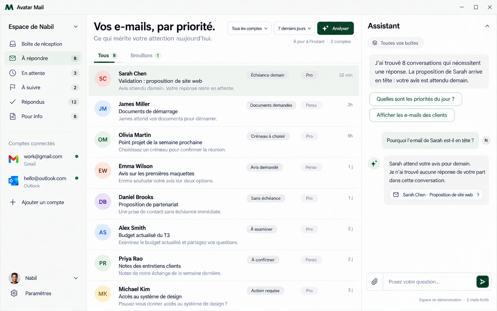
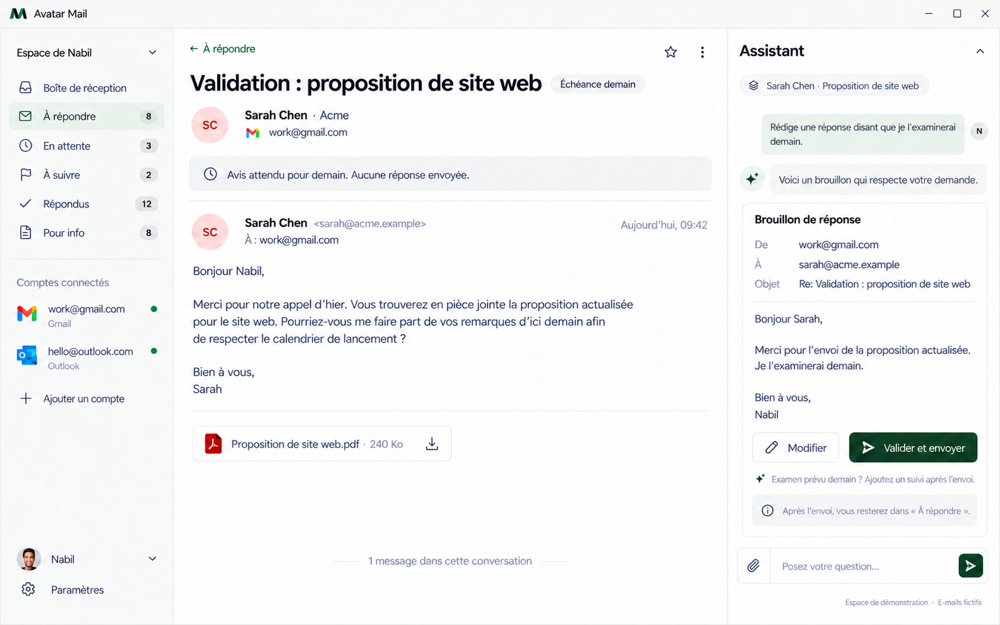
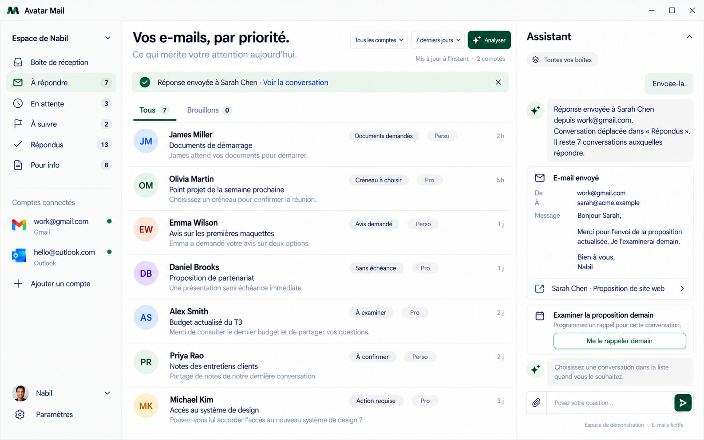

# Avatar Mail — Maquettes en français

Avatar Mail est un produit AvaTaR AI : un espace de travail avec tableau de bord et assistant conversationnel, accessible sur le web et dans une application de bureau partageant le même service cloud.

Ces trois images traduisent les dernières maquettes approuvées. Elles illustrent le parcours suivant.

## 1. Boîte de réception priorisée

Les conversations sont classées avec une courte explication concrète : échéance, demande de documents ou créneau à choisir. Les comptes sont identifiés par des libellés compacts.

## 2. Conversation et brouillon

Le client lit la conversation et demande un brouillon dans le chat. Les champs De et À restent visibles. Le brouillon respecte précisément la demande : « Je l’examinerai demain », sans ajouter de promesse de retour le lendemain. Le client peut modifier, puis valider l’envoi.

## 3. Après l’envoi : rester dans la liste

La conversation envoyée quitte « À répondre » et devient accessible dans « Répondus ». Le client reste sur la liste priorisée et choisit lui-même la prochaine conversation : aucun autre e-mail ne s’ouvre automatiquement.

Une réponse envoyée ne signifie pas que le travail promis est terminé. Le chat propose « Me le rappeler demain » pour suivre l’examen de la proposition. Ce rappel n’est pas encore programmé tant que le client ne le choisit pas.

## Vues du tableau de bord

- **À répondre** : conversations nécessitant une réponse.
- **En attente** : conversations en attente d’une action ou réponse d’un tiers.
- **À suivre** : engagements et suivis à traiter.
- **Répondus** : conversations auxquelles une réponse a été envoyée.
- **Pour info** : messages ne nécessitant pas de réponse.

Les contrôles d’analyse et la rédaction dans le chat restent ceux de la version approuvée.

Les images ont été générées et traduites avec l’outil de génération d’images intégré. Les noms, messages et comptes sont fictifs. Il s’agit de maquettes visuelles, pas d’une application fonctionnelle. Les états de communication et de suivi peuvent coexister : une conversation répondue peut encore nécessiter un suivi.
