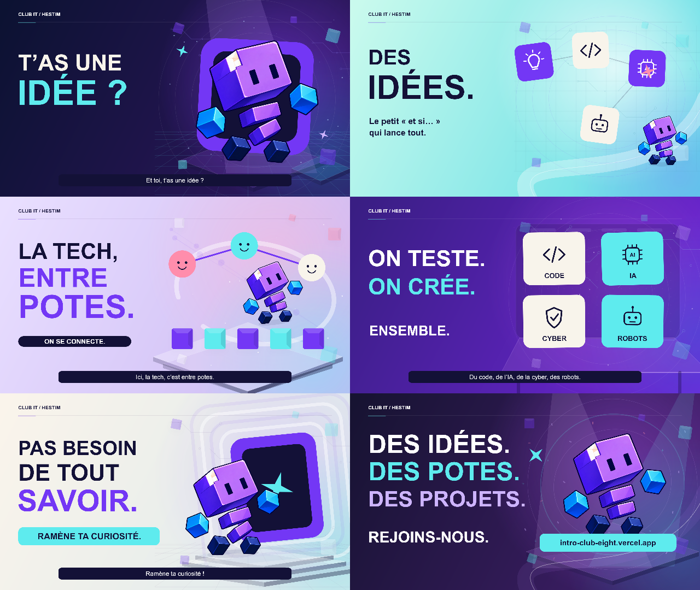
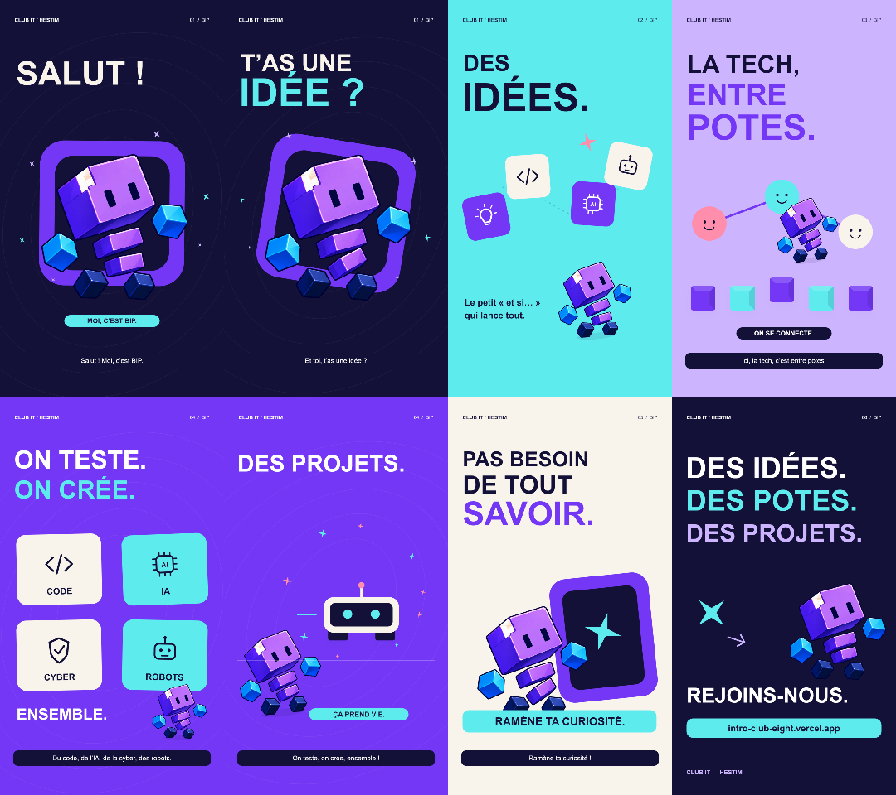

# BIP — Club IT HESTIM

Première version complète de la vidéo de présentation du club en motion graphics, avec BIP, la voix française B2 approuvée, une musique originale et des effets sonores.

**Des idées. Des potes. Des projets.**

## Version TV — mise à jour

[Voir ou télécharger la vidéo TV Full HD](assets/bip-club-motion-graphics/bip-club-tv-1080p.mp4)

Format paysage 16:9, 1920 × 1080, 30 images par seconde. Les compositions sont adaptées à un téléviseur, avec des décors animés enrichis. Les numérotations « BIP / 01 » en haut à droite sont retirées de toutes les scènes. Voix, musique et durée conservées.

## Version verticale originale

[Voir ou télécharger la vidéo MP4](assets/bip-club-motion-graphics/bip-club-motion-graphics.mp4)

[Télécharger les sous-titres français SRT](assets/bip-club-motion-graphics/captions.fr.srt)

## Format

- Durée : environ 30 secondes.
- Vidéo verticale : 1080 × 1920, 30 images par seconde.
- MP4 H.264, audio AAC stéréo à 48 kHz.
- Sous-titres français intégrés à l'image et disponibles séparément.

## Déroulé

1. BIP s'assemble et se présente.
2. Une idée devient des éléments de code, d'IA et de robotique.
3. Les éléments se connectent : la tech entre potes.
4. Le club explore le code, l'IA, la cybersécurité et les robots ; un robot prend vie.
5. BIP invite chacun à venir avec sa curiosité.
6. Le slogan et l'invitation à rejoindre le club concluent la vidéo.

Page interactive du club : [intro-club-eight.vercel.app](https://intro-club-eight.vercel.app).

Version créée le 4 novembre 2026. Animation et musique produites localement ; narration issue des enregistrements B2 déjà approuvés. Cette version reste disponible pour revue par l'équipe du club.
