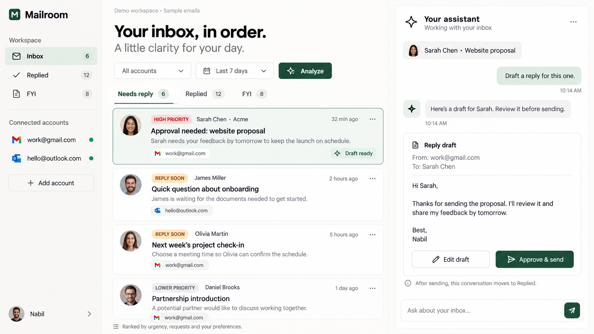

# AI Email Workspace — Visual Mockup

A workspace that brings multiple email accounts into one prioritized inbox, with a chat assistant for drafting and sending replies.

## Customer workflow

1. Log in and connect one or more email accounts, including accounts from different providers. Connections persist unless reauthorization is required.
2. Choose the accounts and a timeframe: 7 or 30 days.
3. Analyze conversations and rank them by importance. Each result includes a short summary and a reason for its priority.
4. Select a conversation and ask the chat assistant to draft a reply.
5. Review or edit the draft, then explicitly approve sending from the correct account.
6. After successful sending, move the conversation from **Needs reply** to **Replied**.

## Dashboard views

- **Needs reply:** conversations requiring a response, ordered by priority. Drafts remain here until sent.
- **Replied:** conversations the customer has answered.
- **FYI:** relevant conversations that do not appear to need a reply.

Replies sent directly through the email provider should also update the dashboard. New incoming messages should trigger reassessment: a new question can return a conversation to Needs reply, while a simple acknowledgment need not.

## Design direction

Connected accounts and navigation sit on the left, ranked conversations in the center, and the assistant with an editable reply draft on the right. Chat and dashboard share the same conversation and draft state.

**Mailroom** is a placeholder name. All names, emails, counts, and messages in the image are sample content. This is an AI-generated visual concept, not a working application. Provider connections, ranking, drafting, and sending are proposed behavior.

## Latest approved revision

The product is now named **Avatar Mail**. See the [latest approved mockups in French](avatar-mail-maquettes-fr.md), including follow-ups and staying on the ranked list after sending without automatically opening another conversation. The original image above is retained as an earlier concept.
