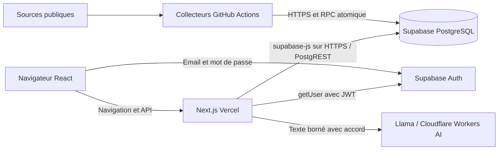
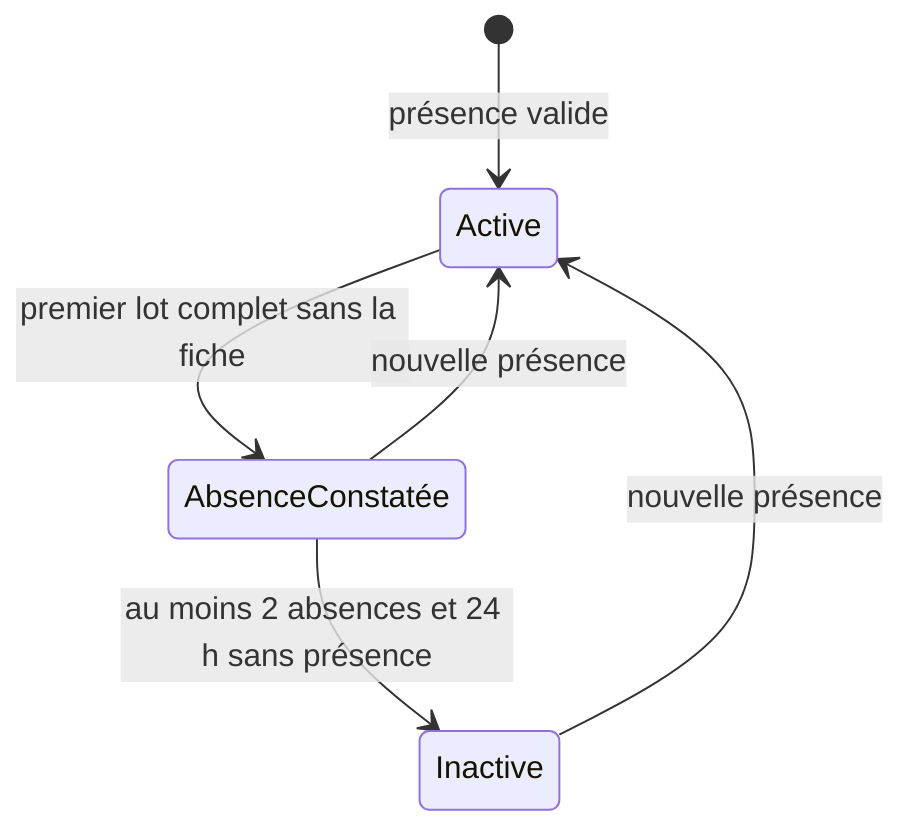
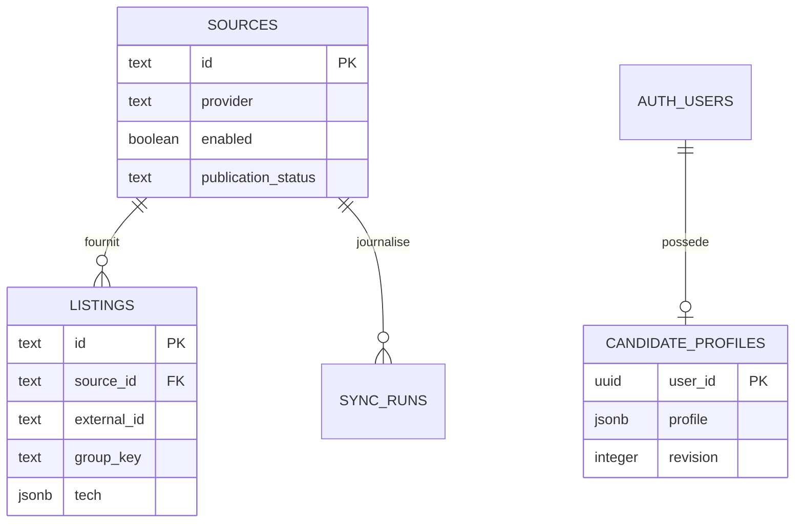
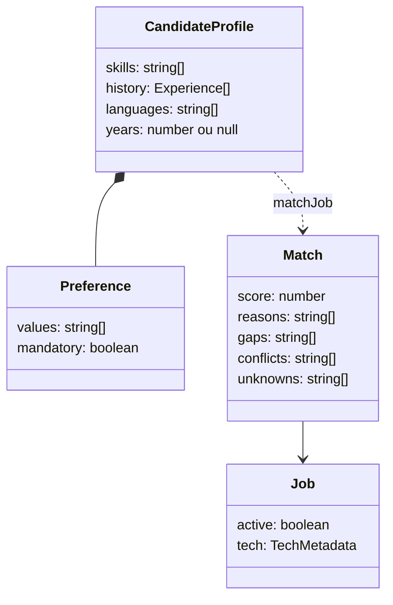
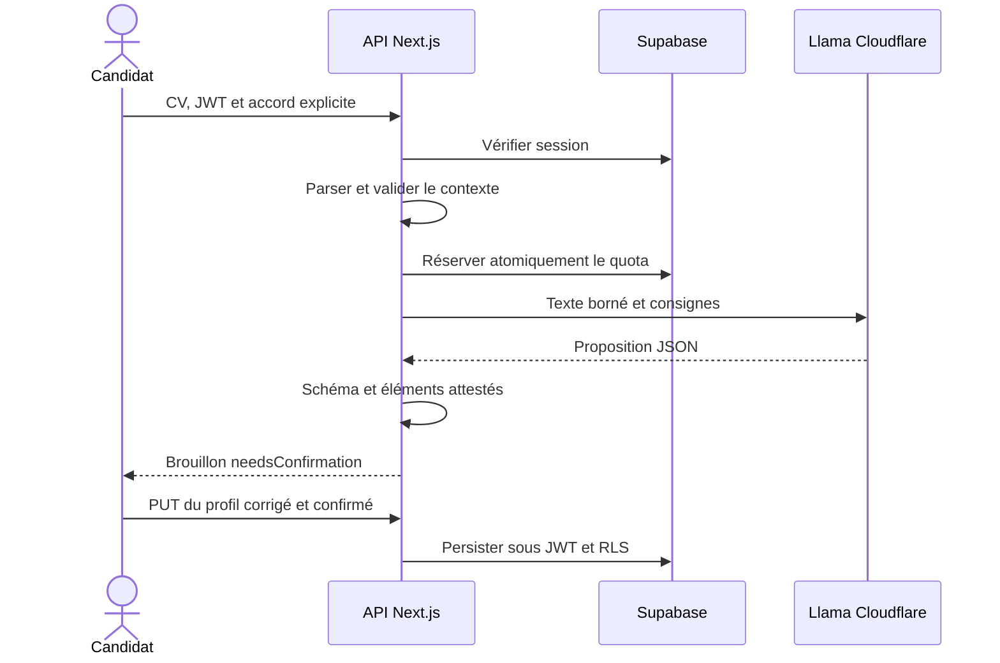

# Dossier technique Virtus

Révision de soutenance du **25 novembre 2026**. Ce dossier est la source de vérité du PowerPoint. Référence applicative : `569fbdfab90888e8e0c4bda3d8e8c96f30f1c653` sur [main](https://github.com/yassine-yki/VIrtus_mainrepo/tree/569fbdfab90888e8e0c4bda3d8e8c96f30f1c653). Les noms restent Intervenant 1 et Intervenant 2. La répartition orale ne constitue pas une attribution des contributions de développement.

## 1. Problème, objectifs et périmètre

Les annonces pour le Maroc sont réparties entre plusieurs sites. Virtus centralise les faits utiles, groupe les doublons et conserve la candidature sur la source d'origine. Le produit couvre emplois employeurs, concours publics et remote explicitement accessible depuis le Maroc. Le catalogue `/tech` ajoute familles métier, technologies, niveaux, langues requises et stages/PFE. La période par défaut est trente jours avec toutes dates disponibles. Une date inconnue ne devient pas une date récente.

Le parcours candidat est « importer un CV, confirmer son profil, examiner les correspondances ». Le modèle extrait un brouillon structuré. La classification et le classement restent déterministes. Le produit n'envoie pas de candidature et ne prend pas de décision de recrutement.

Code : `src/lib/types.ts`, `search.ts`, `tech.ts`, `matching.ts`, `src/components/candidate-workspace.tsx`.

## 2. Parcours utilisateur et interactions

L'accueil statique `/` occupe l'écran sans défilement. EXPLORER, TECH & IT, STAGES & PFE, TÉLÉTRAVAIL et MON PROFIL ouvrent leurs destinations. Survol et focus clavier changent le fond. Le composant garde au plus deux couches, attend le décodage et ignore une image devenue obsolète. En échec, il conserve un fond disponible. Le mode de mouvement réduit reste respecté.

Les filtres vivent dans l'URL. Pagination et retour depuis `/offres/[id]` conservent ces critères. Une navigation Next.js peut éviter un nouveau document tout en demandant au serveur du contenu de route. Les formulaires HTML gardent un parcours de base. React met à jour le DOM depuis l'état des composants client. Les pages serveur et API interrogent Supabase.

Sous 768 px, le formulaire et ses espaces sont compacts, les catégories défilent horizontalement et les logos passent après résultats et pagination. Le lien original précède les métadonnées secondaires du détail mobile. Le panneau reste sticky sur ordinateur. Navigation et filtres commencent fermés sur mobile et deviennent visibles par CSS sur ordinateur, sans effet de montage qui augmente la hauteur. Le thème est sélectionné tôt. `ResultsAnchor` repositionne `#offres` après l'arrivée du contenu streamé.

Preuve datée du 25/11 : premier emploi à 883 px du haut du document à une largeur de 390 px, contre environ 1 450 auparavant. Viewports 320, 390, 768, 1024 et 1440 px contrôlés sans débordement dans le parcours testé. Taille de texte système et appareils physiques restent à tester.

Code : `category-navigation.tsx`, `header-navigation.tsx`, `filter-disclosure.tsx`, `results-anchor.tsx`, `catalog-page.tsx`, `src/app/globals.css`. Captures publiques réelles et rapport JSON joints.

## 3. Architecture et connexion réelle à Supabase

Schéma simplifié et éditable, repris par des objets natifs dans le PowerPoint :

La consultation ne collecte pas les sites d'emploi. Elle lit le catalogue synchronisé. `supabase-js` utilise HTTPS, Data API/PostgREST et `.rpc()`, sans connexion PostgreSQL directe par visiteur. Le catalogue utilise la clé publishable. Les opérations candidates vérifient le JWT et le propagent à la base. La collecte utilise une clé privilégiée dans l'environnement GitHub protégé `collection`. Les migrations emploient `pg.Client`, une URL PostgreSQL opérateur, une transaction et un verrou.

Code : `src/lib/catalog.ts`, `candidate-server.ts`, `scripts/collect.ts`, `scripts/migrate.ts`.

## 4. Sites et méthodes de collecte

Le registre local contient 34 entrées activées à la révision étudiée. Une entrée est un compte ou un flux, pas nécessairement une entreprise distincte. L'état en base détermine l'activation et la publication effective. Cette liste ne garantit pas une offre fraîche pour chaque source.

| Méthode | Sources du registre |
|---|---|
| SmartRecruiters, API JSON | Accor, Accor Hotels, ALTEN, Devoteam, SQLI, Inetum, Egis, SOCOTEC, Bosch, Veolia, SGS, Wavestone, Scalian, Alter Solutions |
| Greenhouse, API JSON | Nuitée, Wikimedia Foundation, Cloudbeds, Artefact |
| Lever, API JSON | Energy Recovery, Yassir, Theodo |
| Workable, API publique | Mindera, Infomineo, Arcsen, SupportYourApp |
| Ashby, API publique | Harmattan AI, The Flex |
| Adaptateurs employeurs mixtes | Capgemini (Jobstream et détails), CGI (Njoyn), Cegedim (DigitalRecruiters) |
| Teamtailor, RSS et sitemaps | inwi, Leyton Maroc |
| API spécialisée | Wadifa Info (concours), Himalayas (remote) |

Les URL officielles de chaque compte figurent dans `presentation/measurements/benchmark.json`, champ `sources`, et dans les audits du dépôt. Orange reste désactivé faute de pagination complète validée. LinkedIn, Indeed, ReKrute et Emploi.ma ne sont pas collectés.

Une API JSON ne nécessite pas d'extraire des sélecteurs HTML. RSS et sitemaps énumèrent des fiches à vérifier. L'accès technique ne constitue pas une autorisation générale de republier une annonce. Virtus publie des faits et liens selon le périmètre approuvé et conserve les attributions. Himalayas reste exclu de `/api/jobs` même si ses annonces peuvent apparaître dans l'interface.

Le remote exige une admissibilité Maroc explicite. « Remote », « worldwide » ou « EMEA » seuls ne suffisent pas.

Code : `src/lib/sources.ts`, fichiers JSON employeurs, `src/collectors/connectors.ts`, `employer-sites.ts`, `teamtailor.ts`, `himalayas.ts`, `wadifa.ts`. Audits : `docs/SOURCES.md` et documents employeurs/remote.

## 5. Collecte, validation et cycle des annonces

`collect.yml` demande `17 */6 * * *`, toutes les six heures à la minute 17 UTC. GitHub peut retarder les exécutions. La matrice lance un job par source, `max-parallel: 2`, `fail-fast: false`, timeout de 25 minutes. Le groupe de concurrence sérialise les runs sans annuler le précédent. Himalayas ajoute une cadence quotidienne.

Le collecteur enregistre d'abord la source et respecte son état en base. Les appels imposent HTTPS, hôtes autorisés, timeout et retries bornés avec Retry-After. Les adaptateurs contrôlent pagination, totaux, identifiants et doublons avant réconciliation. Wadifa est appelé au plus une fois par run avec cadence spécifique. Un lot de 2 000 records sans preuve de complétude est refusé. Aucun PDF de concours ni dossier candidat n'est extrait.

Nettoyage HTML/texte encodé, villes et contrats normalisés, dates originales et URL canonique produisent des clés stables. Un concours sans ville indique Maroc sans correspondre à une ville filtrée. Il ne devient pas un CDI. La deadline est une date civile dans `Africa/Casablanca`.

La clé `(source_id, external_id)` identifie une fiche. `group_key` groupe entreprise et URL canonique. Une annonce affichée peut donc regrouper plusieurs liens sources. Une chute de plus de moitié d'un lot antérieur d'au moins dix annonces déclenche un refus conservateur. La RPC `commit_source_sync` revérifie l'état de source et synchronise atomiquement annonces, source et journal. Elle ne permet pas au collecteur d'écraser une approbation de publication. Un échec conserve le lot antérieur et n'expire pas les absentes.

Le masquage public est indépendant : source suspendue, manque de fraîcheur, expiration ou fin de la journée de concours. Un échec n'allonge pas la visibilité. Himalayas autorise une couverture globale minimale de 95 %, enregistre l'évidence partielle et ne ferme pas une fiche simplement absente de son flux partiel. Sa visibilité peut utiliser le succès récent de source avec `expires_at`. Le matching ajoute un filtre de 72 h sur `last_seen_at`.

Code : `scripts/collect.ts`, `src/collectors/http.ts`, `src/lib/normalize.ts`, `deadline.ts`, `source-policy.ts`, migrations catalogue et `20261121230612_himalayas_partial_collection.sql`.

## 6. Base et modèle du domaine

Schéma simplifié : les migrations font autorité. Les annonces conservent publication, présence, activité, compteur d'absence, expiration et champs concours. `sync_runs` conserve résultat et évidence de couverture. `candidate_profiles` contient seulement le profil structuré confirmé, sa révision et son propriétaire. `virtus_private` contient configuration et réservations de budget sans accès client direct. Les correspondances ne sont pas persistées : elles se calculent à la demande.

Le projet emploie des interfaces et fonctions TypeScript. Ce diagramme UML ne suppose ni ORM ni classes exécutables. Le score reste interne au tri et disparaît de la réponse paginée.

## 7. Import du CV et Llama

Le parser accepte PDF texte et DOCX jusqu'à 4 000 000 octets, 30 000 caractères extraits et 30 pages PDF. Un processus isolé borne mémoire et durée. Le contenu décompressé DOCX est limité. Aucun OCR n'est fourni. Le corps HTTP est borné avant parsing. L'application ne persiste ni l'original ni le texte intégral.

Compétences, historique, formation, projets, langues et expérience sont structurés. Les préférences flexibles/obligatoires sont confirmées par le candidat, sans inférence depuis une omission du CV. Le serveur contrôle alias canoniques et présence des éléments dans le texte. Cette validation réduit les erreurs sans prouver l'exactitude de tout le CV. L'utilisateur corrige avant enregistrement. Un import échoué ne remplace pas le profil confirmé précédent.

Le code conserve un adaptateur Hugging Face, mais le pilote a choisi Cloudflare Workers AI avec `@cf/meta/llama-3.3-70b-instruct-fp8-fast`. Les paramètres serveur exigent flags, modèle autorisé, prix versionnés, vérification du plan gratuit et revue de confidentialité. Aucune bascule automatique payante n'existe. Les flags et quotas réels doivent être revérifiés avant une démonstration.

Contexte Cloudflare borné à 24 000 tokens avec une limite d'entrée réservant instructions et sortie. Caractères, octets et tokens ne sont pas interchangeables. Une entrée trop longue est rejetée explicitement. Le texte du CV reste non fiable et ne peut ni exécuter un outil ni changer les instructions. Une sortie valide est encore un brouillon.

Une réservation SQL atomique précède l'appel et inclut les deux tentatives maximales. Le maximum est cinq réservations par utilisateur et jour UTC, avec plafond mensuel de valeur réservée d'au plus 10 USD. Il s'agit d'un plafond applicatif conservateur, pas d'une facture ni d'une garantie de service gratuit. Une tentative échouée peut consommer la réservation. La saisie manuelle et le matching restent disponibles sans extraction.

La documentation Workers AI consultée le 25/11/2026 annonce absence d'entraînement sur les contenus et traitement sans rétention pour l'inférence standard, sous conditions et exceptions. Cela ne promet pas la suppression de tout log, gateway ou service tiers. Le candidat doit recevoir une information et donner son accord.

Code : `src/lib/cv-parser.ts`, `cv-extraction.ts`, `src/app/api/profile/extract/route.ts`, `docs/CLOUDFLARE-CV-SETUP.md`.

## 8. Matching déterministe et explications

La classification versionnée traite chaque rôle, pas l'employeur entier. Elle couvre logiciel, données/IA, cloud/DevOps, cybersécurité, QA, support/réseaux, ERP et produit technique. Elle distingue mentions et exigences identifiées. Une information sans preuve reste inconnue.

Le matching charge toutes les offres tech visibles par `get_tech_catalog`, puis vérifie activité, exclusion des concours, fraîcheur 72 h et période trente jours ou toutes dates. Une offre doit partager une famille ciblée **ou au moins deux technologies canoniques**. Une préférence obligatoire doit être explicitement compatible : inconnue ou contradictoire, elle exclut l'offre. Une préférence flexible peut produire un conflit ou une inconnue.

| Élément | Calcul interne |
|---|---|
| Famille | 40 points si famille ciblée commune |
| Technologies | 35 × part des exigences couvertes, ou des mentions si aucune exigence identifiée |
| Niveau | 15 points si le niveau figure dans les préférences confirmées |
| Langues exigées | 10 × part des langues exigées présentes dans le profil |

L'expérience explicite produit une raison ou un conflit sans ajouter un cinquième poids. Nom, âge, photo, genre et nationalité ne servent pas au classement. Les poids sont heuristiques. Le score ne constitue pas une probabilité d'embauche.

Le tri utilise score, date originale puis clé stable. Tous les résultats admissibles restent accessibles par pages de douze. Le JSON retire le score mais conserve raisons, exigences « non indiquées dans votre profil », conflits et inconnues. Le classement est recalculé à la visite ou après édition, avec la révision du profil.

Code : `src/lib/matching.ts`, `tech.ts`, `profile.ts`, `src/app/api/matches/route.ts`.

## 9. APIs et contrats

| Route | Contrat principal | Accès |
|---|---|---|
| GET `/api/jobs` | jobs, total, page, pageSize, facettes, sources, horodatages, mode | Public et politique export |
| GET `/api/profile` | Profil confirmé et révision | JWT |
| PUT `/api/profile` | `CandidateProfile` validé | Propriétaire |
| DELETE `/api/profile` | Supprime le profil confirmé | Propriétaire |
| POST `/api/profile/extract` | PDF/DOCX ou texte, `x-cv-consent: accepted` | JWT et quota |
| GET `/api/matches` | days=0 ou 30, page, total, explications, révision | Profil confirmé |

Paramètres : `q`, `city`, `contract`, `workplace`, `source`, `days`, `sort`, `kind`, `page`, `tech`, `family`, `technology`, `seniority`, `language`, `pfe`. Les sélections multiples restent des paramètres répétés. Exemple sans secret : `/api/jobs?tech=1&technology=python&technology=sql&days=0&page=2`.

Erreurs candidates : 401 session invalide, 404 fonctionnalité désactivée, 409 profil requis, 413 corps trop grand, 400 parsing illisible, 422 contexte/sortie invalide, 429 réservation refusée, 503 indisponibilité. Aucun corps d'erreur fournisseur brut n'est transmis. Réponses privées : `private, no-store`, `noindex`, `Vary: Authorization`. Réponse publique : `no-store`.

## 10. Sécurité et séparation des secrets

Les GRANT SQL donnent accès aux objets/colonnes. La RLS limite les lignes. Les nouvelles vues et RPC publiques sont `security_invoker`. Elles ne réexposent pas les descriptions complètes réservées à l'opérateur. Une clé publishable n'est pas un secret d'administration.

`candidateSession` vérifie le JWT via `getUser`, refuse un utilisateur anonyme Supabase et propage ce JWT à la base. La politique de profil impose `auth.uid() = user_id` avec `USING` et `WITH CHECK`. Le client ne peut donc pas choisir un autre propriétaire. Les tables de budget restent privées. La réservation utilise une fonction privilégiée étroite, avec vérification d'identité et verrou de configuration.

Le secret de collecte reste dans GitHub `collection`, les tokens IA restent côté serveur Vercel et les migrations utilisent une identité opérateur. Aucun token réel ne doit apparaître dans une capture, un exemple ou une diapositive.

Le pilote email/mot de passe fonctionne sans confirmation email selon la décision produit, avec minimum huit caractères. Un email non vérifié ne prouve pas la propriété de l'adresse et ne doit pas accorder un droit d'entreprise. Noindex, flags et protection de preview ne remplacent pas l'autorisation. La CSP actuelle contient notamment `frame-ancestors`, `object-src`, `base-uri` et ne doit pas être décrite comme protection exhaustive.

L'analyse de code et les tests RLS ne remplacent pas un audit d'intrusion indépendant. Code : `candidate-server.ts`, `next.config.ts`, migration `20261117205938_virtus_tech_profiles.sql`.

## 11. CI/CD et runtime Vercel

Sur push/PR, `checks.yml` utilise Node 24, dépendances épinglées, installation frozen-lockfile, typecheck, tests et build. Le build prépare `.cv-runtime` puis exécute `next build --webpack`. Versions : Next 16.4.5 et React 19.3.1.

L'accueil statique peut être servi par le réseau Vercel. Les catalogues et API privées exécutent du code serveur. L'extraction requiert Node, un processus enfant et les dépendances de parsing. `prepare-cv-runtime.mjs` matérialise les fichiers nécessaires et `outputFileTracingIncludes` les inclut. Un runtime Edge ne les remplacerait pas directement.

Vercel fournit previews de branches puis production depuis main. Les migrations restent des opérations distinctes : objets additifs avant callers, déploiement puis smoke tests. `vercel.json` demande `dub1`. Les en-têtes observés durant la release confirment Dublin pour les routes dynamiques, près du projet Supabase irlandais.

PR 13 à 16 : région, mobile, requêtes, assets/interactions. Le [run CI 45668170363](https://github.com/yassine-yki/VIrtus_mainrepo/actions/runs/45668170363) et le statut Vercel de 569fbdf ont été vérifiés réussis pour ce dossier. Cela ne prouve pas une collecte ultérieure réussie.

Rollback : restaurer un déploiement vérifié antérieur. En cas de caller SQL défectueux, reprendre le déploiement pré-caller tout en gardant les fonctions additives et les anciennes RPC. Ne pas supprimer des données ou changer une permission pour masquer un incident.

## 12. Optimisation des lectures et mesures

`search_tech_catalog` renvoie douze offres, total, page normalisée, entreprises, facettes et horodatages. La fonction conserve accents normalisés, mots-clés, OR par catégorie et AND entre catégories, ordre déterministe, doublons et dates. La facette ville ignore le filtre ville, la facette source ignore le filtre source. `get_catalog_source_summary` remplace la demande d'une page d'emplois pour `/sources`.

La vue `catalog_search_jobs` agrège les liens une fois par groupe. Les contrôles de visibilité, source, fraîcheur, concours et export Himalayas restent actifs. `get_tech_catalog` reste utilisé pour le matching exhaustif. Les anciennes RPC sont conservées pour rollback. Aucun cache de résultats publics n'a été ajouté.

Les plans inspectés lors de la release ont montré environ 555 ms pour l'ancienne recherche générale, 351 ms pour le catalogue tech complet, 51 ms pour la recherche tech paginée et 36 ms pour le résumé. Ces fonctions et volumes de sortie diffèrent : il ne s'agit pas d'une comparaison contrôlée de requêtes identiques. Les plans bruts ne sont pas joints. Ces observations sont à reproduire avant une revendication indépendante. Aucun index n'a été ajouté sans gain établi.

### HTTP en production, 25 novembre 2026

Cinq requêtes publiques séquentielles par route depuis le même poste. Mesure jusqu'à réception complète du HTML, pas affichage visuel. Premier appel archivé séparément, sans garantie de cold start. Aucun trafic concurrent généré. Données brutes avant, Dublin seul, après requêtes et fin de release jointes.

| Route | Avant médiane ms | Finale médiane ms | Baisse arrondie | Premier avant / après ms |
|---|---:|---:|---:|---:|
| `/` | 100 | 58 | 42 % | 586 / 670 |
| `/offres` | 1 035 | 606 | 41 % | 1 901 / 737 |
| `/tech` | 1 376 | 202 | 85 % | 1 428 / 281 |
| `/sources` | 1 050 | 190 | 82 % | 1 067 / 190 |
| `/profil` | 163 | 94 | 42 % | 163 / 126 |
| Détail SRE | 866 | 173 | 80 % | 866 / 176 |

Ces gains cumulent plusieurs changements et ne doivent pas être attribués entièrement à Dublin. L'accueil a une médiane plus basse mais un premier échantillon final plus lent : aucune amélioration uniforme de chaque requête ne peut être annoncée. Les valeurs répétées séparées sont dans le rapport JSON.

Les images sont responsive et optimisées, sans double téléchargement original/optimisé pour une même transition. Le WebP 640 px observé fait 23 308 octets contre 237 246 pour l'original. Douze polices/logos portent une empreinte versionnée et un cache immutable d'un an.

### Mesure visuelle distincte

Lighthouse mobile : Moto G Power émulé, Slow 4G, version 13.6.0. Accueil : performance 100, LCP 0,8 s, CLS 0, TBT 40 ms. Catalogue : performance 100, LCP 0,9 s, CLS 0, TBT 30 ms. Un run de laboratoire par route, aucune donnée terrain et aucun INP utilisateur. Ces scores ne décrivent pas tous les réseaux ou appareils.

Rapports datés du 25/11 : [accueil](https://pagespeed.web.dev/analysis/https-virtus-jobs-vercel-app/vzzgk3dl4q2jmaijwzg8io?form_factor=mobile), [catalogue](https://pagespeed.web.dev/analysis/https-virtus-jobs-vercel-app-offres/0vyuijrunvucod47zl445s?form_factor=mobile).

### Fonction de classement isolée

Benchmark du 25/11 à 08:17 UTC, Node v24.22.3 : un processus, offres synthétiques identiques préclassifiées, dix échauffements et cinquante mesures séquentielles par taille. Pour 10 000 offres : p50 39,57 ms et p95 41,91 ms. Ni réseau, ni SQL, ni LLM, ni cold start. Il ne démontre aucun nombre d'utilisateurs simultanés. Le script et le JSON historique sont joints. Un rerun créera un nouvel échantillon, pas une reproduction exacte des temps.

## 13. Tests et qualité des preuves

La release passe **81 tests**, typecheck et build dans la CI applicative. La suite couvre normalisation, connecteurs mockés, PDF/DOCX synthétiques, profils, matching et accès. PGlite applique les migrations dans PostgreSQL embarqué pour tester notamment RLS, transactions, réservations et visibilité. Cela ne remplace pas l'infrastructure Supabase réelle.

La parité de recherche en production documente 24 scénarios et des comptes de sources concordants sur l'instantané. Les fixtures SQL couvrent accents, tags multiples, facettes, pertinence, dates inconnues, pages hors plage, sources bloquées/désactivées, échéances et export.

Le benchmark interne `title-v1` utilise 100 titres étiquetés, dont 32 positifs. Il reconnaît 25 vrais positifs sans faux positif : précision 100 %, rappel 25/32 = 78,125 %. Le test contrôle aussi la précision des tags émis au seuil de 95 %. Cette fixture n'est pas indépendante et ne mesure ni satisfaction des candidats ni qualité générale du matching.

Les contrôles HTTP et navigateur piloté ont examiné recherche, lien original, pagination, thème, clavier et viewports. **Aucune suite Playwright dédiée ni test de charge HTTP reproductible n'apparaît dans les scripts actuels.** Une dépendance transitive ne prouve pas une suite e2e.

Protocole futur : préproduction isolée, données synthétiques, rampe de concurrence et mesures p50/p95, débit, erreurs, mémoire, SQL et coût. Séparer catalogue, matching et extraction simulée. Pour la pertinence : candidats consentants, annotations indépendantes, baseline mots-clés, jeu de contrôle séparé, Precision@5 et faux négatifs. Les résultats restent à produire.

## 14. État opérationnel, difficultés et limites

Le run planifié [45578132719](https://github.com/yassine-yki/VIrtus_mainrepo/actions/runs/45578132719), consulté pour cette livraison : 34 jobs source, 32 succès, Wadifa et Veolia en échec, concurrence observée au plus deux. Il précède la release de performance et utilise un autre SHA. Un succès peut correspondre à un skip de cadence. Les timestamps Supabase de ce run n'ont pas été revérifiés dans ce dossier : aucune nouvelle preuve de synchronisation complète n'est revendiquée.

Diagnostic : identifier source et run, lire l'étape fautive, distinguer HTTP, pagination, validation et RPC, puis comparer `sync_runs`, `last_success_at`, fraîcheur et statut public. Ne pas réconcilier un lot incomplet. Une suspension ciblée relève d'un opérateur autorisé. Aucune source ou permission n'a changé pour cette présentation.

Défis : pagination Orange incomplète, intitulés ambigus, parser PDF natif, packaging pnpm/Vercel, alias LLM et continuité des filtres pendant le redesign. Réponses : source laissée désactivée, règles conservatrices, parser isolé, runtime matérialisé, validation de sortie et contexte URL conservé.

Goulots restants : SQL sous cardinalité élevée, transfert complet et tri du matching en mémoire, latence modèle, quotas et durée d'extraction. Les évolutions doivent découler de mesures de concurrence/coût. Un cache public exige une invalidation compatible avec suspension et deadlines. Les profils n'entrent pas dans un cache partagé.

## 15. Démonstration, notes et timing

18 minutes hors questions : Intervenant 1, slides 1–9, **8 min 35**. Intervenant 2, slides 10–18, **9 min 25**. Les 18 annexes restent cachées au défilement normal. Cette proposition n'invente pas les contributions individuelles.

La slide 3 réserve 70 secondes : accueil, Tech, filtre technologie, détail, lien original et retour filtré. Préparer un profil synthétique. Ne pas dépendre d'un appel modèle en direct dans cette durée. Avant soutenance, vérifier flags et quotas si une extraction doit être montrée. Aucun CV réel ni jeton sur l'écran.

Secours livré : captures réelles desktop, catalogue mobile et détail, plus UML du parcours candidat. En panne réseau, expliquer ces captures sans prétendre à des clics fonctionnels hors ligne. Aucune vidéo n'a été enregistrée. La capture mobile mesure 844 px de haut, le premier emploi commence à 883 px : elle ne prétend pas le montrer.

Les notes de chaque slide principale contiennent intervenant, durée, script, point technique, clics, références et transition orale. Fades manuels, aucun avancement automatique. Blocs numérotés révélés un par un et conservés. Les diagrammes restent complets. Un rendu statique ne prouve pas la lecture native PowerPoint.

## 16. Agents IA et maîtrise humaine

La réalisation a été largement assistée par agents. L'équipe doit le déclarer selon le règlement de l'établissement. Ne pas avoir lu toutes les lignes du dépôt ne démontre pas une maîtrise suffisante. La compétence se vérifie en retraçant une requête jusqu'à SQL, expliquant RLS, recalculant un score et diagnostiquant un refus de collecte.

Les plans validés fixent périmètre et critères. `AGENTS.md` impose les docs de la version Next installée. Les skills fournissent des procédures spécialisées. Diffs, PR, CI et corrections constituent des traces. Ce dossier et sa présentation utilisent le skill de présentation et des lectures ciblées du code. La présence d'un skill ne prouve pas son usage pendant toute l'histoire du projet.

Les critères de choix d'un modèle de développement sont difficulté, qualité, latence et coût. Aucun historique exhaustif des modèles de développement n'est attesté ici. Le modèle Llama d'extraction est identifié dans le code. L'équipe doit préciser ses contributions réelles.

## 17. Registre de preuves

| Preuve | Portée et limite |
|---|---|
| Code main 569fbdf | Fonctionnement inspecté, pas garantie future |
| CI 45668170363 et statut Vercel | Tests, build et déploiement à cette révision |
| `performance-*.json` | Échantillons HTTP séquentiels, aucune charge concurrente |
| `performance-report-2026-11-25.json` | Synthèse datée, limites et captures |
| `benchmark.json`, `benchmark.ts` | Calcul synthétique de fonction |
| `collection-run-45578132719.json` | Jobs GitHub sans nouvelle jointure de timestamps SQL |
| `tech-labelled-jobs.json` du dépôt | Fixture interne, pas étude indépendante |
| PNG du produit | Captures réelles datées, pas mockups |

Les chemins de code sont relatifs au dépôt applicatif à 569fbdf. Les notes donnent les liens versionnés. JSON, CSV et scripts Matplotlib accompagnent les graphiques. Les objets de graphiques, tableaux et UML du PowerPoint sont éditables.

Documentation officielle consultée le 25/11/2026 : [régions Vercel](https://vercel.com/docs/functions/configuring-functions/region), [RLS Supabase](https://supabase.com/docs/guides/database/postgres/row-level-security), [Workers AI et données](https://developers.cloudflare.com/workers-ai/platform/data-usage/). Les docs expliquent le fournisseur et le code précise l'usage réel.

## 18. Vérifications encore nécessaires

- Lecture native PowerPoint : animations, clics et annexes cachées.
- Répétition chronométrée, noms et contributions exactes.
- Quotas et fournisseur disponibles le jour de la démo.
- Pertinence humaine et baseline indépendante.
- Charge HTTP concurrente, appareils physiques et texte système agrandi.
- Diagnostic Wadifa/Veolia et jointure GitHub/Supabase avant affirmation de refresh complet.
- Archivage des plans SQL bruts avant revendication indépendante des temps SQL.

La production et son infrastructure n'ont pas été modifiées pour ce dossier.
